# Домашняя работа 3. Cassandra

В папке scripts находятся вспомогательные CQL-запросы для демонстрации схемы, чтения событий и трассировки.

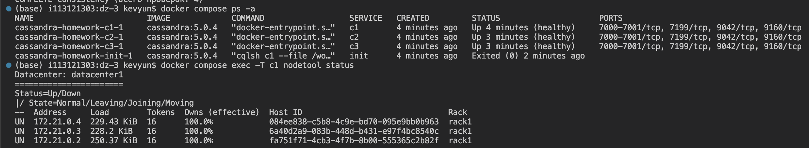

Кластер из трёх узлов.

## 2. Таблица и модель данных

Партиция по user_id позволяет читать события пользователя без обхода всей таблицы. Кластеризация по event_time DESC сразу возвращает последние событя первыми.

Два события с одинаковыми user_id и event_time попадут в одну строку: второй INSERT обновит её по правилу last-write-wins. Для аудита это риск потери события. Я бы добавил уникальный event_id timeuuid в ключ: PRIMARY KEY (user_id, event_time, event_id).

data: passed.

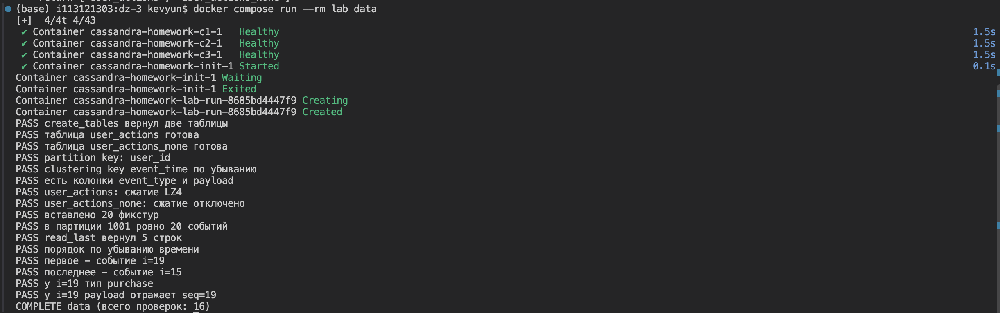

Таблицы и контрольные события.

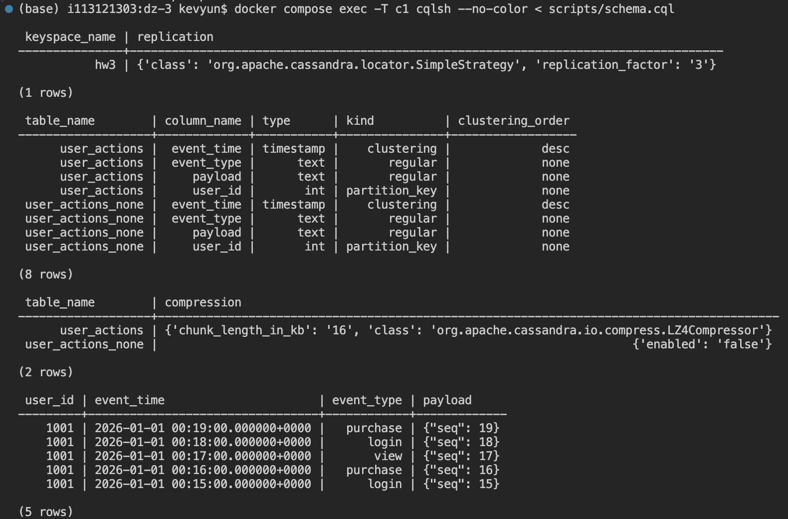

Ключи, сжатие и порядок событий.

## 3. Вставка и чтение

| Что вставлено | Сколько | Время |
|---|---|---|
| События пользователя 1001 (login, purchase, view) | 10 000 | 10.995 с |

Среднее время одной записи: 10.995 с / 10000 = 1.0995 мс. Замер относится к user_actions. В обеих таблицах по 10 000 событий, последние пять читаются в порядке seq от 9999 до 9995.

PreparedStatement позволяет подготовить запрос перед циклом и повторно выполнять его с разными значениями через bind. Это сокращает повторый разбор CQL и отделяет значения от текста запроса.

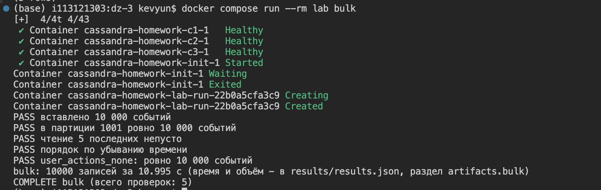

Вставка 10 000 событий.

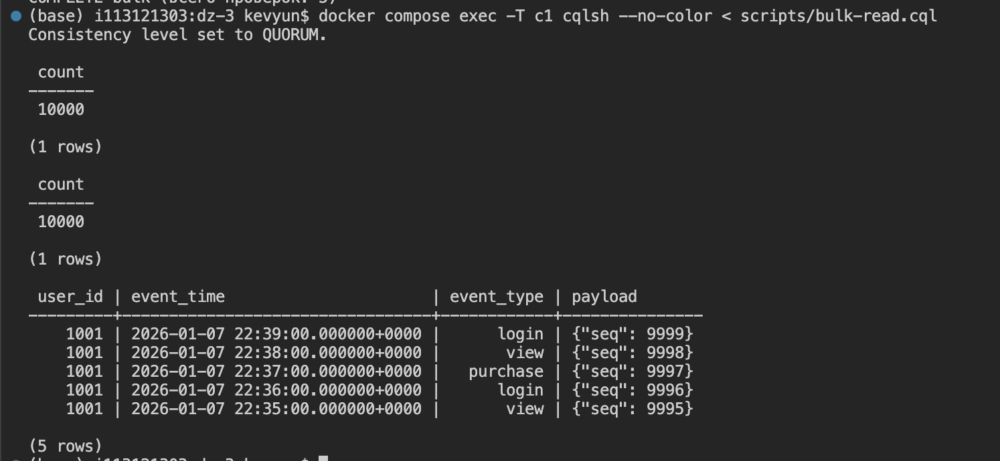

Последние пять событий.

## 4. Консистентность

В таблице приведены медианы пяти прогонов после одного прогрева. Запись - суммарное время для 1000 событий, чтение - один запрос последних 20 событий.

| Уровень | Запись, мс | Чтение, мс |
|---|---|---|
| ONE | 1081 | 4 |
| QUORUM | 3207 | 5 |

В формуле W + R > N буква N - число реплик, W - число подтверждений записи, R - число ответов при чтении. При N = 3 для ONE достаточно одной реплики: 1 + 1 <= 3, поэтому чтение может вернуть старые данные. QUORUM требует две реплики: 2 + 2 > 3. Наборы реплик пересекаются, поэтому quorum-чтение видит успешно подтверждённую quorum-запись, если её не заменило другое обновление. Это предполагает корректные временные метки. Запись отправляется всем репликам; уровень определяет, сколько подтверждений ждать.

Для ленты аудита я выбрал бы QUORUM при записи и чтении: важно сразу видеть подтверждённые события. Это требует больше ответов, чем ONE, но при RF = 3 допускает отказ одного узла.

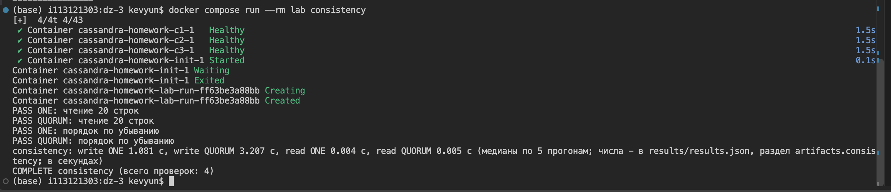

Медианы ONE и QUORUM.

## 5. Сжатие

Я снял статистику на c1 после загрузки одинаковых данных и flush. Размеры указаны в байтах.

| Таблица | Space used (total) | SSTable count | SSTable Compression Ratio |
|---|---|---|---|
| user_actions (LZ4) | 153503 | 1 | 0.38564 |
| user_actions_none (без сжатия) | 388949 | 1 | -1.00000 |

Сжатие требует CPU при flush и компакции, а чтение - распаквоки блока. Взамен Cassandra хранит и читает меньше байтов. Для повторяющихся типов событий и JSON это выгодно. Значение -1.00000 у второй таблицы означает, что сжатие отключено.

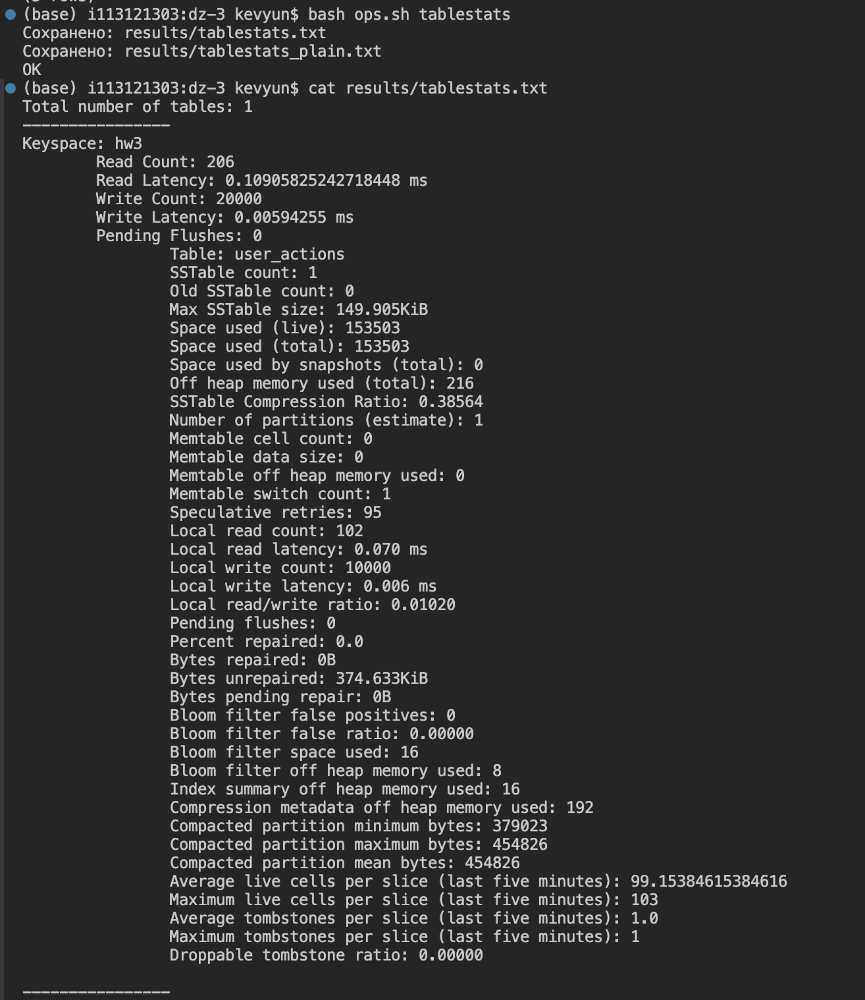

Таблица с LZ4.

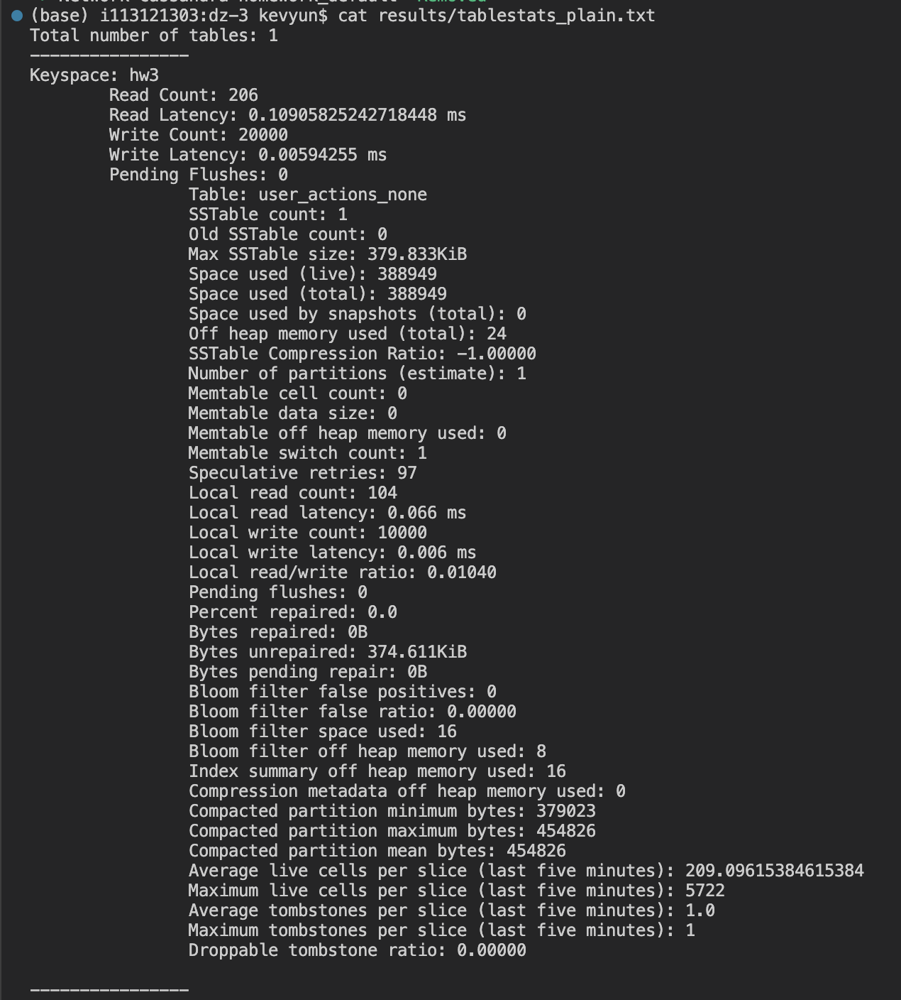

Таблица без сжатия.

## 6. Bloom-фильтр

| Показатель | Значение |
|---|---|
| Bloom filter false positives | 0 |
| Bloom filter false ratio | 0.00000 |

Bloom-фильтр проверяет наличие ключа партиции в SSTable. Ответ «точно нет» позволяет пропустить поиск на диске в этом файле. Ответ «возможно есть» требует проверки и может оказаться ложным.

false positives - число таких ложных срабатываний, false ratio - их доля среди положительных проверок фильтра. В моём прогоне их не было. Фильтр полезен для отсутствующих ключей и большого числа SSTable; при полном сканировании или редком чтении его роль меньше.

## 7. Repair

Я выполнил nodetool repair hw3. В results/repair.txt есть финальные сообщения Repair command #1 finished in 0 seconds и Repair completed successfully.

Anti-entropy - синхронизация расхождений между репликами вне обычного чтения. Repair сравнивает данные по диапазонам токенов с помощью деревьев хешей и передаёт различия. Он нужен после длительных простоев и пропущенных обновлений, а также регулярно при работе кластера.

Без repair реплики расходятся, и чтение может вернуть старые данные. Для безопасной очистки tombstones реплики нужно синхронизировать до окончания gc_grace_seconds. Иначе маркеры могут сохраняться дольше в зависимости от настроек, а после их удаления есть риск восстановления старых записей.

Read repair исправляет только данные и реплики, затронутые чтением. Hinted handoff доставляет сохранённые обновления после короткого простоя узла. Они не заменяют регуляный repair.

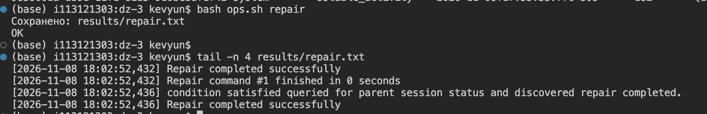

Синхронизация реплик.

## 8. TTL и компакция

| Показатель | Значение |
|---|---|
| Стратегия компакции | TimeWindowCompactionStrategy |
| default_time_to_live | 2592000 |
| События с TTL 5 секунд: до / после истечения | 5 / 0 |

Окно TWCS настроено на один день. Чтение партиции 3001 с TRACING ON вернуло пустой результат. В трейсе есть Read 0 live rows and 10 tombstone cells. Выполнил принудительную компакцию, история сохранена в results/compaction.txt.

TWCS группирует SSTable по времени записи, поэтому файлы с полностью истёкшими данными можно удалять целиком. STCS объединяет файлы по размеру и может смешивать данные разных возрастов, что мешает такому удалению. Поэтому TWCS подходит для журнала с TTL.

TTL отсчитывается от записи и определяет, когда данные перестают читаться. gc_grace_seconds задаёт защитный срок перед удалением tombstones; здесь он равен 864000 с, то есть 10 дням. Место освобождается при компакции после выполнения условий безопасного удаления.

TTL удобнее массового DELETE: срок задаётся при записи, отдельный процесс поиска и удаления старых событий не нужен. При этом TTL тоже оставляет tombstones.

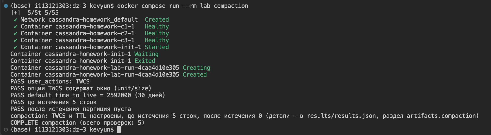

TTL: 5 строк → 0.

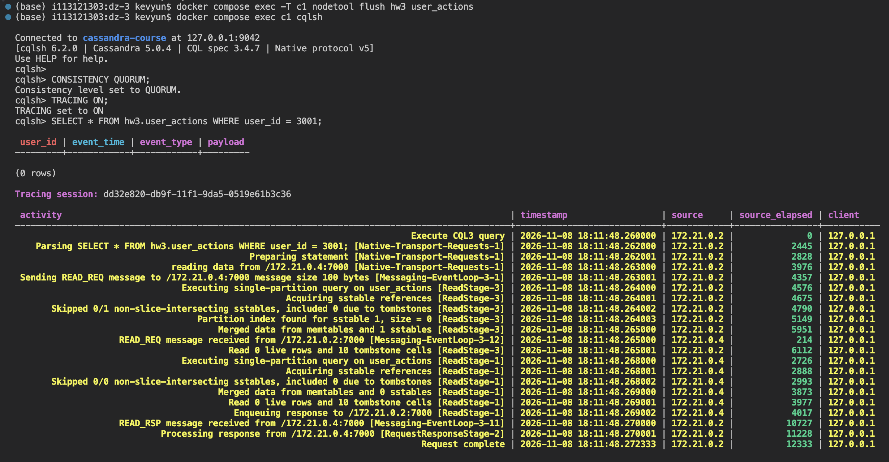

10 tombstone cells.

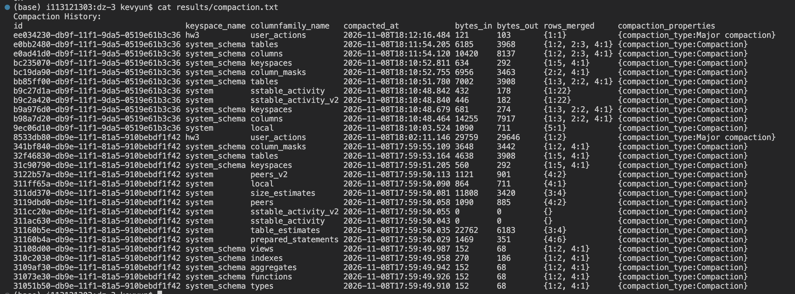

История компакции.

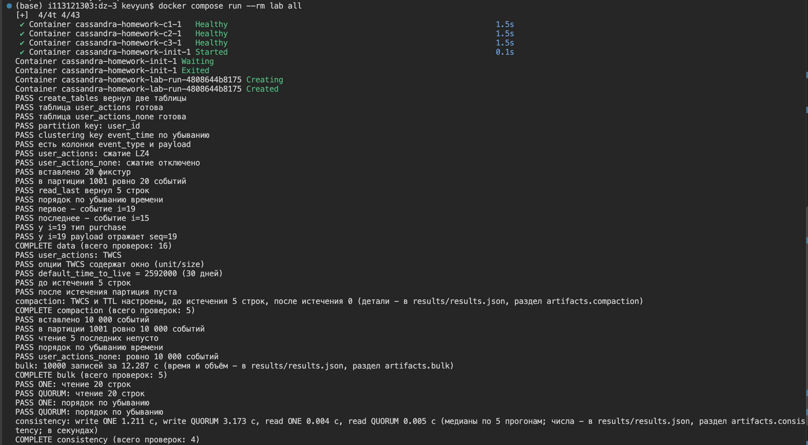

Общий прогон сценариев.

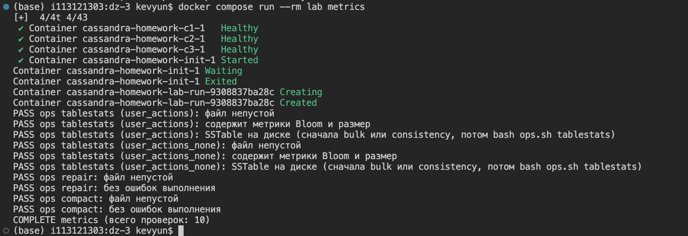

Файлы результатов.
